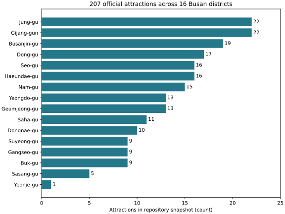
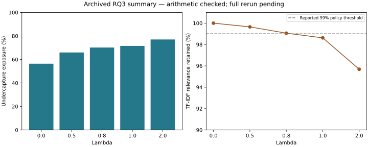

# Busan Tourism Equity Research

**Algorithmic Visibility and Tourism Spending Inequality: An Economic-Equity-Aware Tourism Recommendation Framework for Busan**

Can a tourism recommender broaden visibility toward districts that capture a
smaller share of foreign-tourist spending while preserving relevance and travel
convenience? This research combines a working attraction-search MVP with
previously reported offline economic-equity experiments.

**Current evidence status:** the 207-attraction API is reproducible from this
repository. Published economic results are archived summaries whose arithmetic
has been checked; the 768-row panel, combined research JSON, original benchmark,
and experiment scripts are not in this checkout. The full economic and distance
studies have **not** been independently rerun here.

[Audit and inventory](docs/research/AUDIT_2026-11-13.md) ·
[Data dictionary](docs/data_sources/DATA_DICTIONARY.md) ·
[Reproduction guide](docs/research/REPRODUCE.md) ·
[Sources and reuse](docs/research/SOURCES_AND_REUSE.md) ·
[Paper and professor documents](manuscript/README.md)

## Research questions and contribution

1. **RQ1:** How concentrated are foreign visitor activity and foreign-card tourism spending across Busan districts?
2. **RQ2:** How does a controlled text recommender distribute exposure, and how does that exposure relate to visitor/spending shares?
3. **RQ3:** Can economic-undercapture re-ranking change simulated exposure while retaining text relevance and reasonable accessibility?

The proposed contribution is a transparent framework for comparing relevance,
district visibility and economic-undercapture signals. It is not a claim that
commercial platforms caused inequality, or that simulated exposure increased
actual visits, local revenue or tourist satisfaction.

## Data and provenance

| Material | Available in this repository | Verification |
|---|---|---|
| Official Busan attractions | 207-row CSV; full 207-item and partial 10-item API JSON | 207 unique IDs, 16 districts, coordinates, exact raw-to-CSV projection checked |
| District-month panel, 2022–2025 | Reported as 768 rows; **not available here** | Complete dates, missingness, joins and CSV/JSON consistency remain unverified |
| Historical Data Lab exports | 16 Haeundae files and two city-total files | Inventoried; not a substitute for the 16-district panel |
| Economic experiment outputs | Small archived CSV summary tables | Arithmetic and aggregate exposure concentration checked |
| Literature/manuscript | Markdown reports; empty reference template | Original article draft and verified literature still needed |

Sources are [Korea Tourism Data Lab](https://datalab.visitkorea.or.kr/datalab/portal/main/getMainForm.do)
and the [Busan Attractions Information Service](https://www.data.go.kr/data/15063481/openapi.do).
The attraction cleaner maps raw fields and removes exact duplicate full records;
no raw data are edited or missing text imputed. The current CSV has 207 records
and no duplicate IDs. Optional text gaps are documented in the dictionary.

**Data warning:** `data/raw/foreign_spending_raw.csv` is identical to the visitor
file and contains visitor counts, not spending. Both have only Busan city totals
for October 2025–September 2026. They must not be used as the research panel.
Haeundae total-consumption headers use million KRW; industry data use thousand
KRW. Original foreign-card filter settings need confirmation.

No new source datasets are published in this update. Existing files are
preserved; their presence in Git does not establish reuse rights. New raw data,
private panels, combined JSON and credentials are ignored pending review.

## Two distinct recommendation models

### Working API prototype

The baseline indexes `main_title`, `subtitle`, `place`, `district`, `address`
and `transport_info` using TF-IDF with English stop-word filtering and cosine
similarity. The corpus contains mixed-language metadata; English query matches
are limited by that content. Ties preserve original CSV order.

The current equity endpoint uses **`prototype_attraction_distribution_proxy`**:

```text
equity_score = (maximum district attraction count - district attraction count)
               / (maximum count - minimum count)
final_score = (1 - equity_weight) * relevance_score + equity_weight * equity_score
```

This is a dataset-representation proxy, not economic inequality. Only
positive-relevance attractions within the baseline's top 50 are re-ranked;
results may be fewer than the requested limit. All five endpoints are preserved.

### Reported offline economic study

The documented research model uses 2024–2025 visitor and spending aggregates:

```text
benefit_capture_ratio = spending_share / visitor_share
economic_undercapture = max(0, 1 - benefit_capture_ratio)
final_score = relevance * (1 + lambda * economic_undercapture)
```

This multiplicative model is **not implemented by the current API equity
endpoint**. Its lambda is not the API's equity_weight. The archived study reports
48 queries across 12 categories, 33 eligible queries with at least five positive
matches, top-10 lists from top-50 positive candidates, and rank weights
`1/log2(rank+1)`. See [methods](docs/research/METHODS_AND_METRICS.md).

## Archived findings and verification limits

The following values come from existing summary CSVs. Their arithmetic agrees;
this does not establish that the original experiments were rerun.

| Reported measure | Baseline | Economic policy, lambda=0.80 |
|---|---:|---:|
| Undercapture-district exposure | 56.41% | 70.14% |
| TF-IDF relevance retained | 100% | 99.06% |
| Yeongdo + Seo exposure | 15.95% | 21.38% |
| District exposure Gini | 0.3263 | 0.2983 |
| District exposure HHI (recomputed from saved shares) | 0.08337 | 0.08010 |
| District coverage | 15/16 | 15/16 |

The exposure gain is **13.74 percentage points**, not a measured spending gain.
Reported RQ1 pooled visitor/spending correlations (Pearson 0.5726, Spearman
0.7242) cannot be recomputed without the panel. Category, bootstrap and temporal
robustness claims also await original inputs/scripts.





Figures are newly rendered from existing counts and summary tables by
`scripts/build_figures.py`; no original research figures were found locally.
[Detailed checks](docs/research/AUDIT_2026-11-13.md) distinguish recalculation from
full reproduction. Accessibility summaries use Haversine **straight-line**
distance around three stations, not public-transport travel time. Their station
coordinates and filtering code are missing.

## Professor-Ready MVP

Use Python 3.12. From the repository root:

```bash
python -m venv .venv
source .venv/bin/activate
python -m pip install -r requirements.txt
python -m uvicorn src.api.main:app --reload
```

Open <http://127.0.0.1:8000/docs> and use **Try it out**.

| Endpoint | Inputs |
|---|---|
| `GET /api/health` | None |
| `GET /api/attractions` | Optional `district` |
| `GET /api/recommend/baseline` | Required `query`; `limit=10` |
| `GET /api/recommend/equity` | Required `query`; `limit=10`; `equity_weight=0.20` (0–1) |
| `GET /api/compare` | Same inputs; both lists and unique district counts |

For `sea cafe photography`, limit 10, weight 0.20, the baseline returns **10**
items and the prototype returns **9 positive-relevance items**; both cover seven
districts. A zero-score baseline item is not evidence of a relevant match.
See the [derived JSON example](results/reports/mvp_demo.json), which stores IDs
and scores rather than republishing the source descriptions/images.

Future research will replace the attraction-distribution prototype with verified
foreign-tourist spending, visitor activity, algorithmic visibility and
accessibility data. Newer Mac-only code must be inspected before integration.

## Reproduce available checks

```bash
python -m pip install -r requirements-research.txt
python -m unittest discover -s tests -v
python scripts/verify_repository.py --output work/audit.json
python scripts/run_mvp_experiment.py --output work/mvp_demo.json
python scripts/build_figures.py
```

The validator is read-only. To rebuild the attraction projection safely, use
`python src/clean_attractions.py --output work/attractions_rebuilt.csv` with a
fresh filename. Existing outputs are never overwritten.

An offline RQ3 rerun was successful from recovered private archive inputs on
2026-11-13. The public script still needs private economic scores to rerun. Follow the [reproduction guide](docs/research/REPRODUCE.md)
and [sync status](docs/research/REPRODUCIBILITY_STATUS.md); do not manufacture the
missing benchmark or treat summary arithmetic as an independent rerun.

## Repository map and paper preparation

- `src/api/`: existing FastAPI prototype, unchanged in the audit.
- `src/analysis/`: tested concentration and exposure metrics.
- `scripts/`, `tests/`: read-only auditing, demonstration, figure creation and checks.
- `data/`: existing files preserved in place; private additions ignored.
- `experiments/`, `results/tables/`: existing archived summaries, unchanged.
- `results/figures/`, `results/reports/`: explicitly labeled derived artifacts.
- `docs/data_sources/`: dictionary and baseline manifest.
- `docs/research/`: methods, evidence status, audit and synchronization plan.
- `manuscript/README.md`: index to preserved professor reports and missing drafts.

Next: verify private archive provenance and permissions, extend robustness checks,
evaluate actual travel times, freeze a held-out multilingual benchmark, and verify
literature citations with the professor. An exploratory two-reviewer human relevance
pilot has now been collected; it does **not** establish representative tourist
satisfaction or formal equivalence. No observed revenue effect, causal intervention
or commercial-platform audit has been established.

## Exploratory human relevance pilot (13 November 2026)

Two people rated **61** unique query–attraction items over **six** searches, with
**52** items rated 1–5 by both reviewers (zero means cannot judge). Exact
agreement was **34.6%** and quadratic-weighted Cohen's κ was **0.490**.

Only **three of the six searches** had complete judgments for strict baseline
vs equity comparison. In those three, mean rank-weighted human relevance was
**3.849/5** (baseline) and **3.859/5** (economic policy λ=0.8), a tiny,
non-significant descriptive difference. The pilot indicates particular
relevance weaknesses for **local market** and **photography walk** queries.

[Read the methods and findings](docs/research/HUMAN_RELEVANCE_PILOT_2026-11-13.md) ·
[Aggregate data and reproducibility notes](experiments/human_relevance/README.md)

Only anonymized aggregate results and the calculation script are committed.
Individual reviewer ratings, blind policy key and item-level workbook are
kept private pending consent and ethics review.

## Reproducible RQ3 milestone (13 November 2026)

The saved 33-query, five-policy **economic** reranking experiment was rerun
from the recovered private archive and matched the archived summary results.
The public code does not expose underlying district spending or visitor data.
The 48 fixed searches are a **development benchmark**, not held-out evidence.

[Reproduction record](docs/research/RQ3_REPRODUCTION_2026-11-13.md) ·
[Run script](experiments/equity/reproduce_rq3.py) ·
[Full paper roadmap](docs/research/PAPER_ROADMAP_2026-11-13.md).

## New manuscript draft — 13 November 2026

[Read the full Introduction and Related Work draft](manuscript/INTRODUCTION_AND_RELATED_WORK_2026-11-13.md) with a checked bibliography and a cautious research-gap synthesis. The research gap remains **provisional**, and the official visitor-count estimates are **not deduplicated district residents or unique tourists**.
